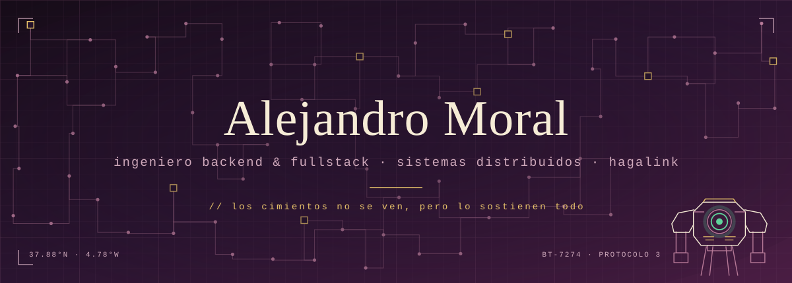

Construyo productos SaaS de punta a punta, desde la toma de requisitos hasta producción: microservicios en NestJS y Go, pagos e IA aplicada (RAG y agentes), siempre con TDD y arquitectura limpia. Vivo en Córdoba, España.
Soy ingeniero backend y fullstack en [Hagalink](https://hagalink.es), donde me encargo de que la base sobre la que corre toda la línea de producto aguante.
